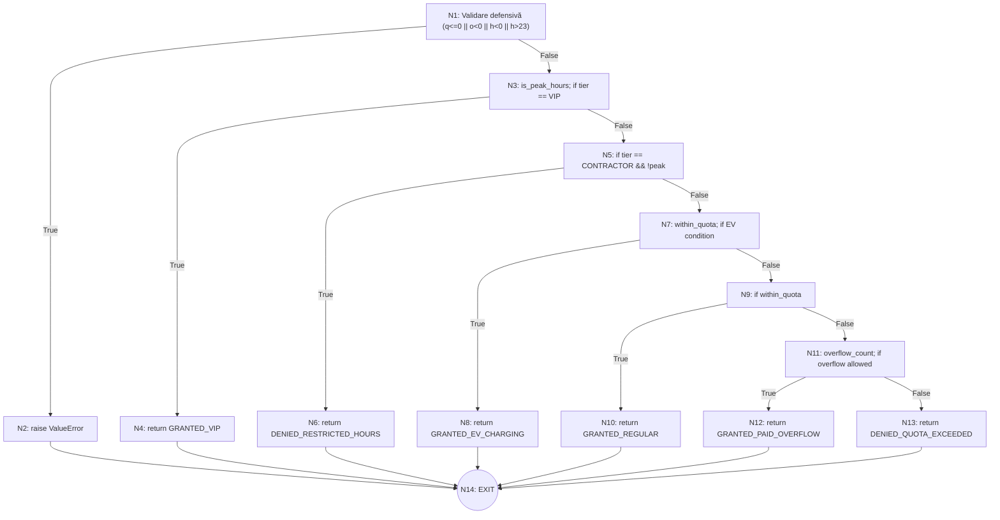

# Cerința 3: Testare Structurală — Graful de Control (CFG) și Complexitatea Ciclomatică

**Autor:** Natalia Moroz (50% contribuție)  
**Metoda analizată:** `evaluate_parking_access` din [`src/parking_gate.py`](../src/parking_gate.py)

---

## 3.1. Graful Orientat de Control (Control Flow Graph - CFG)

Pentru a analiza fluxul de execuție, programul este descompus în blocuri de bază (noduri) și tranziții decizionale (arce).

### 1. Catalogul Nodurilor

| Nod | Linie Cod | Conținut / Operație | Tip Nod |
| :---: | :---: | :--- | :---: |
| **N1** | 45-53 | Start & Verificare validare defensivă (`q <= 0 or o < 0 or h < 0 or h > 23`) | Predicat |
| **N2** | 54 | `raise ValueError(...)` | Ieșire Eroare |
| **N3** | 57-60 | Calcul `is_peak_hours` & Verificare `tier == VIP` | Predicat |
| **N4** | 61 | `return AccessDecision.GRANTED_VIP` | Ieșire |
| **N5** | 64 | Verificare `tier == CONTRACTOR and not is_peak_hours` | Predicat |
| **N6** | 65 | `return AccessDecision.DENIED_RESTRICTED_HOURS` | Ieșire |
| **N7** | 68-71 | Calcul `is_within_quota` & Verificare condiție acces EV | Predicat |
| **N8** | 72 | `return AccessDecision.GRANTED_EV_CHARGING` | Ieșire |
| **N9** | 75 | Verificare `is_within_quota` | Predicat |
| **N10** | 76 | `return AccessDecision.GRANTED_REGULAR` | Ieșire |
| **N11** | 79-81 | Calcul `overflow_count` & Verificare condiție overflow | Predicat |
| **N12** | 82 | `return AccessDecision.GRANTED_PAID_OVERFLOW` | Ieșire |
| **N13** | 85 | `return AccessDecision.DENIED_QUOTA_EXCEEDED` | Ieșire Implicită |
| **N14** | — | Nodul terminal comun de ieșire (Exit / End of execution) | Terminal |

---

## 3.2. Reprezentarea Vizuală a Grafului (Diagramă Mermaid)

---

## 3.3. Calculul Complexității Ciclomatice $V(G)$

Complexitatea ciclomatică McCabe $V(G)$ măsoară numărul de circuite liniar independente dintr-un graf orientat și se calculează prin 3 metode echivalente:

### Metoda 1: Formula cu muchii și noduri
$$V(G) = E - N + 2P$$
- Număr de muchii (**$E$**): $19$
- Număr de noduri (**$N$**): $14$
- Componente conexe (**$P$**): $1$
$$V(G) = 19 - 14 + 2(1) = 7$$

### Metoda 2: Formula nodurilor predicat (puncte de decizie)
$$V(G) = P_{\text{predicat}} + 1$$
Nodurile predicat (care au $\ge 2$ arce de ieșire) sunt: $N_1, N_3, N_5, N_7, N_9, N_{11}$ (în total $6$ noduri predicat):
$$V(G) = 6 + 1 = 7$$

### Metoda 3: Formula regiunilor plane
$$V(G) = R$$
unde $R$ este numărul de regiuni închise plus regiunea exterioară neînchisă:
- 6 regiuni închise (generate de cele 6 decizii către nodul N14)
- 1 regiune deschisă (exterioară grafului)
$$V(G) = 6 + 1 = 7$$

> **Concluzie Matematică:** Toate cele 3 metode converg riguros către **$V(G) = 7$**.

---

## 3.4. Baza de Căi Liniar Independente (Basis Paths)

Un set de circuite liniar independente care acoperă **toate arcele** grafului de control este format din $V(G) = 7$ căi:

1. **Calea 1 (Eroare Validare):**  
   $$Path_1: N_1 \to N_2 \to N_{14}$$  
   *Caz de test:* `q = 0` $\implies$ `ValueError`.

2. **Calea 2 (Acces VIP):**  
   $$Path_2: N_1 \to N_3 \to N_4 \to N_{14}$$  
   *Caz de test:* `tier = VIP` $\implies$ `GRANTED_VIP`.

3. **Calea 3 (Restricție Contractor Noapte):**  
   $$Path_3: N_1 \to N_3 \to N_5 \to N_6 \to N_{14}$$  
   *Caz de test:* `tier = CONTRACTOR`, $h = 21$ $\implies$ `DENIED_RESTRICTED_HOURS`.

4. **Calea 4 (Acces Stație Încărcare EV):**  
   $$Path_4: N_1 \to N_3 \to N_5 \to N_7 \to N_8 \to N_{14}$$  
   *Caz de test:* `is_ev = True`, `has_spots = True`, $h = 6$ $\implies$ `GRANTED_EV_CHARGING`.

5. **Calea 5 (Acces Normal în Cotă):**  
   $$Path_5: N_1 \to N_3 \to N_5 \to N_7 \to N_9 \to N_{10} \to N_{14}$$  
   *Caz de test:* `is_ev = False`, `occupied = 5`, `quota = 10` $\implies$ `GRANTED_REGULAR`.

6. **Calea 6 (Acces Overflow Aprobat):**  
   $$Path_6: N_1 \to N_3 \to N_5 \to N_7 \to N_9 \to N_{11} \to N_{12} \to N_{14}$$  
   *Caz de test:* `occupied = 12`, `quota = 10`, `allows_overflow = True`, $h = 10$ $\implies$ `GRANTED_PAID_OVERFLOW`.

7. **Calea 7 (Respingere Cotă Epuizată):**  
   $$Path_7: N_1 \to N_3 \to N_5 \to N_7 \to N_9 \to N_{11} \to N_{13} \to N_{14}$$  
   *Caz de test:* `occupied = 10`, `quota = 10`, `allows_overflow = False` $\implies$ `DENIED_QUOTA_EXCEEDED`.
